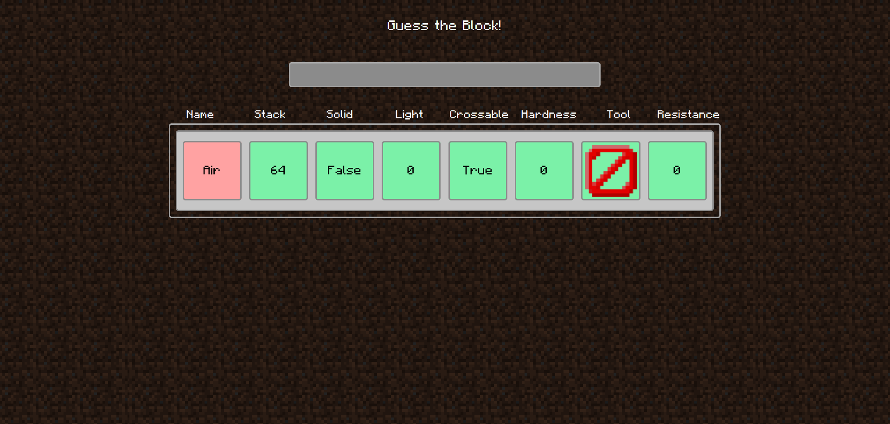
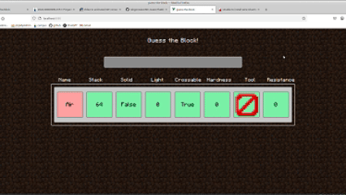
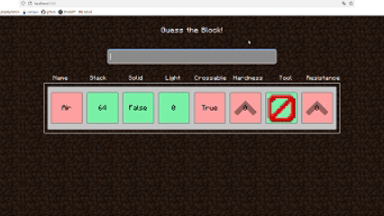

# MC-GuessTheBlock
# Jonay Contreras Rodríguez, Rubén Abreu González

## Guess the Block!


## Index
- [MC-GuessTheBlock](#mc-guesstheblock)
- [Jonay Contreras Rodríguez, Rubén Abreu González](#jonay-contreras-rodríguez-rubén-abreu-gonzález)
  - [Guess the Block!](#guess-the-block)
  - [Index](#index)
    - [Description](#description)
    - [Game modes](#game-modes)
    - [Data source](#data-source)
    - [How to use](#how-to-use)
    - [Deployment](#deployment)
    - [VueDocGen documentation](#vuedocgen-documentation)

### Description
*MC Guess The Block* is a game about guessing the minecraft block by some of its attributes.

- Search the block you want to guess.
<div align="center">
    
</div>

---
- Compare the attributes:
  - Red means wrong
  - Green means right
  - The block you guessed appears first, but whether it is the right one is only revealed after every attribute

<div align="center">
    
</div>

### Game modes
- **Daily** (default): one block per day, the same for every player. Your progress is saved in the browser.
- **History**: replay any previous day (`#/daily/YYYY-MM-DD`) and see your stats.
- **Random**: endless games with a random block.

### Data source
The block data comes from [minecraft-data](https://github.com/PrismarineJS/minecraft-data) (PrismarineJS).
`FakeApi.json` is an exact copy of `pc/1.21.1`. At build time `scripts/build-data.mjs` turns it into a small
static file (`public/data/blocks.json`), so the app needs no server.

`scripts/block-filters.mjs` keeps the pool fun (912 obtainable blocks → 339): it drops shape variants
(stairs, slabs, walls, doors, buttons…), weathered/waxed copper, infested and dead blocks and creative-only
blocks, and collapses families that only differ by colour, wood or coral type (*Purple Shulker Box* → *Shulker Box*,
*Spruce Planks* → *Planks*).

```bash
npm run data            # from ../FakeApi.json (Minecraft 1.21.1)
npm run data -- 1.21.11 # download another version from minecraft-data
```

> [!NOTE]
> Changing the dataset changes which block belongs to each day.

#### 3D blocks
Every guess shows the block as a slowly spinning 3D model, and search results show it next to its name.
`scripts/build-models.mjs` downloads the Minecraft 1.21.1 client jar (cached in `.cache/`), reads the
blockstate and model JSON of each block in its default state and writes `public/models/blocks.json`
(cuboids + inlined textures), which `BlockModel.vue` draws with CSS 3D transforms. Blocks drawn by a
block entity renderer (chests, beds, heads, banners, shulker boxes…) are modelled by hand in
`scripts/entity-models.mjs`. The output is committed, so builds don't need the jar.

```bash
npm run models          # regenerate public/models/blocks.json
```

### How to use
> [!IMPORTANT]
> cd guessTheBlock && npm install

- **Web**
> npm run serve

- **Linux**
> npm run electron:build
>
> ./dist_electron/guess-the-block-0.1.0.AppImage

- **Windows**
> npm run electron:build -- --windows

`./jsonServer.sh` still serves the raw API (`/blocks`, `/items`) with json-server if you want to explore it, but the app no longer needs it.

### Deployment
Every push to `main` builds the web version and publishes it to GitHub Pages (`.github/workflows/deploy.yml`).
Enable it once in **Settings → Pages → Source: GitHub Actions**.

### VueDocGen documentation
- [GameView](guessTheBlock/docs/components/views/GameView.md)
- [GuessView](guessTheBlock/docs/components/views/GuessView.md)
- [SelectBlockView](guessTheBlock/docs/components/views/SelectBlockView.md)
- [HistoryView](guessTheBlock/docs/components/views/HistoryView.md)
- [ResultDialog](guessTheBlock/docs/components/views/ResultDialog.md)
- [BoardHeader](guessTheBlock/docs/components/views/BoardHeader.md)
